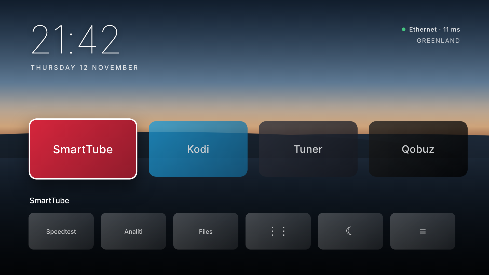

# Drift — a quiet home screen for Android TV

A minimal launcher for the **NVIDIA Shield (2019)** and **Chromecast with Google TV**.
Apple's aerial footage plays behind a big thin clock and one row of favourites. There are no ads,
no recommendation rows and no profiles.


*Mock-up of the layout. On the TV the background is the moving aerial video and the tiles are each app's own banner.*

## ⬇ Download

**[Download Drift 2.0 (APK, 340 KB)](https://andrewf13.github.io/Andrew-s-Playground/downloads/drift-2.0.apk)**. Works on Android TV 9 or newer, including the NVIDIA Shield, Chromecast with Google TV and most Google TV boxes.

**Install it using only the TV remote:**

1. On the TV, install **Downloader** (by AFTVnews) from the Play Store.
2. Open Downloader and type this address:
   `andrewf13.github.io/Andrew-s-Playground/downloads/drift-2.0.apk`
3. When Android asks, allow Downloader to install unknown apps, then choose **Install**.
4. Open **Drift**. Its *Home screen* wizard shows you how to make the Home button open Drift.
   - Choose **Turn on Home button helper**.
   - Switch on **Drift Home button** in Accessibility.
   - Press Back.
5. Optional:
   - In Drift's Settings (the ≡ tile), set **Now playing** to show what your music app is playing.
   - Set **Fade to → Dim when music plays** for night listening.

Each TV keeps its own settings. There's no account, and nothing is shared between devices or sent anywhere.
For a newer version, download and install again over the top; your settings are kept.

[See it in action on the Playground →](https://andrewf13.github.io/Andrew-s-Playground/play.html?project=drift-tv-launcher)

## What it does

| | |
|---|---|
| **Favourites row** | Large 16:9 tiles. Starts as SmartTube, Kodi, Tuner and Qobuz, in that order, picked up automatically by package name or app name. |
| **Apps row** | Every other installed app, including phone-style apps such as network test tools. It ends with *All apps*, *Screensaver* and *Settings*. |
| **Aerial background** | The same Apple TV aerial catalogue that Aerial Dream uses, streamed as muted 1080p H.264 by default (4K is an option). The place each clip was filmed shows top-right. |
| **Ambient fade** | After 45 s with no input, everything except the clock fades away. The first button press only brings the screen back. It never launches anything. |
| **Network chip** | Ethernet or Wi‑Fi, plus a live round-trip time to 1.1.1.1, re-checked every 30 s while you're on the home screen. Green under 60 ms, amber above that or when there's no internet. |
| **Now playing** | Track, artist • album and album art (long names scroll) from Qobuz (or any player) under the clock, staying visible while the screen is faded. Needs a one-off adb grant (see below). |
| **OLED burn-in protection** | The clock block and the info column drift to a new spot every minute, much further once the screen has faded. Static text is also dimmed while faded, and an *Aerial still* background swaps to a new frame every five minutes. |
| **Three clock fonts** | Modern (Roboto Thin), Geometric (Outfit) and Serif (Fraunces). See `docs/fonts.png`. |
| **Screensaver tile** | Opens Aerial Dream's full-screen player straight away. If Aerial Dream isn't installed, Drift's own aerial fills the screen instead. |

### Remote controls

- **OK**: open the app.
- **Hold OK** (or **Menu** on the Shield remote): app options.
  - *Move*: reorder a favourite with ◀ ▶, then press OK.
  - *Add to / remove from favourites*.
  - *Hide from home*.
  - *App info*.
  - *Uninstall*.
- **Back**: closes whatever is open. On the home screen it returns to the first favourite.
- **Home** while already home: resets the screen.

### Night listening (dim mode)

Settings → **Fade to** chooses what happens after *Fade after* with no input:

| Option | What you see |
|---|---|
| **Aerial** (default) | The aerial video with the clock, as before |
| **Dim when music plays** | If something is playing, the screen goes almost black and the aerial stops. Only the album art, title and artist remain, faintly, with an even fainter clock. With no music, it fades to the aerial as usual. |
| **Dim always** | The near-black screen every time |

Any button brings everything back.
On OLED, the faint text drifts further than usual (about ±60dp) every minute, so an hour-long album doesn't mark the screen.
Rows don't wrap: at the first or last tile, Left or Right stays on that row.

### Why it's fast

- It has no dependencies: no AndroidX, Compose or Leanback. The APK is about 80 KB.
- The app list loads once, off the main thread, and stays in memory. It reloads only when apps are installed or removed.
- The window background is already the dusk gradient, so there is no white flash on cold start.
- The video plays on a hardware `SurfaceView` and is **fully released whenever another app is on screen**. Drift never holds a decoder or bandwidth while SmartTube, Kodi or Tuner is playing. It also never requests audio focus, so Qobuz keeps playing on the home screen.

## Install with a computer (optional)

From a PC on the same network, with **Developer options → Network debugging** turned on for the TV:

```bash
adb connect <tv-ip>:5555
adb install -r drift-2.0.apk   # from the Playground downloads folder
```

Published releases are all signed with the same key, so a newer one installs over the old one with `-r` and your favourites are kept.

## Make it the home screen (no computer needed)

The first time Drift opens, it offers a short **Home screen** wizard. You can also open it from **Settings → Home screen**. Everything in it is done with the remote.

1. **Set Drift as the home app.** This is Android's official "default home" request. It's shown only where the TV supports it; some builds honour it and Google TV ignores it.
2. **Turn on the Home button helper.** This opens Settings → Accessibility; choose **Drift Home button** and switch it on.
   - **What it does:** whenever the built-in home screen comes to the front (Home pressed, after a reboot), Drift brings itself straight back. You may see the old home for a split second.
   - **What it can see:** it's limited to the stock launcher packages, can't read anything on screen and sees no other app. Popular TV launchers such as Projectivy use the same approach.
   - **If the switch is greyed out:** Android blocks accessibility for some sideloaded apps. Go to Settings → Apps → Drift → ⋮ → **Allow restricted settings**, then try again.

When you come back from Android's screens, Drift checks the result and closes the wizard if Home now opens Drift.

### With ADB (optional, cleanest result)

Disabling the stock launcher removes even the split-second flash. This needs adb.

- **Shield:** turn on *Developer options → Network debugging*, then `adb connect <ip>:5555`.
- **Chromecast with Google TV (newer builds):** port 5555 is closed even with USB debugging on, which is the "connection refused" error. Use *Developer options → Wireless debugging → Pair device with pairing code*, then run `adb pair <ip>:<pair-port> <code>` and `adb connect <ip>:<port>` with the port shown on screen.

**Chromecast with Google TV**
```bash
adb shell pm disable-user --user 0 com.google.android.apps.tv.launcherx
adb shell pm disable-user --user 0 com.google.android.tungsten.setupwraith
adb shell cmd package set-home-activity --user 0 com.drift.launcher/.MainActivity
```

**NVIDIA Shield**
```bash
adb shell pm disable-user --user 0 com.google.android.tvlauncher
adb shell cmd package set-home-activity --user 0 com.drift.launcher/.MainActivity
```

**Check it** (should print `com.drift.launcher/.MainActivity`):
```bash
adb shell cmd package resolve-activity --brief -a android.intent.action.MAIN -c android.intent.category.HOME | tail -1
```

Press Home. Drift appears, and pressing Home while already on Drift jumps back to the first favourite.

- **Button Mapper:** if it's installed, make sure it isn't remapping Home, or it overrides all of this.
- **Undo:** `adb shell pm enable com.google.android.apps.tv.launcherx`, plus `…tungsten.setupwraith` on the Chromecast or `com.google.android.tvlauncher` on the Shield.
- **After a Google TV system update:** an update can re-enable the stock launcher. If Home suddenly goes to Google TV again, run the same commands again.

What you give up on Google TV: the *For you* tab, Google TV profiles and the watchlist.
Search with the Assistant button, the YouTube and Netflix buttons, casting and Settings all still work.
Android settings is under **Settings → Android settings** in Drift.

## Drift and the screensaver

While Drift is on screen it keeps the TV awake, so the system screensaver (Aerial Dream) no longer covers Drift's own aerial and clock.

- **Time limit:** after *Stay on at home* hours with no input (4 h by default), Drift lets go. The TV's normal screensaver and sleep take over, so a TV left on doesn't run for ever.
- **Other apps:** in every other app nothing changes, and Aerial Dream still protects a paused Kodi or SmartTube screen from burn-in.

To stop the system screensaver everywhere anyway (not recommended on OLED):
```bash
adb shell settings put secure screensaver_enabled 0     # undo: … screensaver_enabled 1
```

## Aerials

- **Why plain http:** Apple's aerial server presents a certificate Android doesn't trust. Aerial Dream works around this by loading every video over `http://` (its source says *"Apple seems to be using an invalid certificate"*), and Drift does the same.
- **Where the video list comes from:**
  1. Videos you copy into the Aerials folder (see below).
  2. Drift's cached copy of Apple's list.
  3. The list built into your installed **Aerial Dream**. Drift reads it straight out of that app, so playback starts immediately with clips known to work on this TV. Apple's live list is then fetched in the background for next time.
  4. Apple's live list.
  5. A few built-in clips. If Drift ends up here, it tries the other sources again after a minute.
- **Seamless transitions:** about 45 seconds before a clip ends, the next one is opened in a second player with no picture. It reads the file header and fills its buffer while the current clip is still playing. At the end there's a half-second dip to dusk, and the buffered clip starts straight away.
- **Only while Drift is in front:** playback stops the moment anything covers Drift, including Google TV's Settings side panel, so it never competes for memory.
- **Checking what happened:** the bottom of the Settings sheet shows how many clips loaded and from where, plus the last error. If the background stays plain, read that line first.
- **Offline or instant start:** copy `.mov` or `.mp4` files into
  `Android/data/com.drift.launcher/files/Aerials/`, for example with
  `adb push Greenland.mov /sdcard/Android/data/com.drift.launcher/files/Aerials/`.
  Local files take priority and are played with no network at all.
- Drift doesn't replace the Aerial Dream screensaver. Keep Aerial Dream selected as the screensaver.

## Now playing (Qobuz)

Android only shares what's playing with apps that have *notification access*. To grant it:

1. Open **Settings**, then choose **Allow now playing…**.
2. Choose **Open notification access**. Android's own screen opens with Drift selected.
3. Switch Drift on, then press Back. Drift notices the change and turns now playing on.

Drift doesn't read your notifications. It only uses this access to read the media sessions: title, artist and album art.

- **TVs without that screen, such as the Shield:** now playing works through the **Drift Home button** accessibility helper instead. If you've already switched it on for the Home button, there's nothing to do.
  - **How it works:** when a music player posts its playback notification, the helper keeps only that notification's link to the player (its media session). Android's own media controls use the same link.
  - **What it ignores:** every other notification, and anything on screen.
  - **If music was already playing:** pause and play it once so Drift picks it up.
- **If the TV doesn't have that screen:** Drift shows the one-off command instead:
  ```bash
  adb shell cmd notification allow_listener com.drift.launcher/com.drift.launcher.MediaListener
  ```
- **Low-memory TVs:** Android doesn't allow notification access on low-memory TV models at all. Drift says so when it detects one.

## Settings (the ≡ tile)

| Setting | Options |
|---|---|
| Background | Aerial video · Aerial still (pauses on one real aerial frame) · Plain |
| Aerial quality | 1080p (default, lightest on the Chromecast) · 4K |
| Next aerial | Skips to the next clip |
| Clock | System · 24-hour · 12-hour |
| Clock font | Modern · Geometric · Serif |
| Burn-in protection | On (default) · Off |
| Now playing | Any player · Qobuz only · Off |
| Home screen | Opens the home screen wizard; shows ✓ once Home opens Drift |
| Stay on at home | 1 h · 4 h (default) · 8 h · Off (system screensaver as normal) |
| Fade to | Aerial · Dim when music plays · Dim always |
| Fade after | 20 s · 45 s · 2 min · 5 min · Never |
| Start screensaver | Opens Aerial Dream's full-screen player |
| Show hidden apps | Shown when any apps are hidden |
| Android settings | Opens Android settings |

## Build

```bash
cd sources/drift
gradle assembleRelease          # needs the Android SDK; set sdk.dir in local.properties
# → app/build/outputs/apk/release/app-release.apk
```

Kotlin, minSdk 28, targetSdk 34. The source is four files in `app/src/main/java/com/drift/launcher/`:

| File | What it does |
|---|---|
| `MainActivity.kt` | Layout, focus, ambient fade, sheets, network chip |
| `Aerial.kt` | Manifest fetch with a streaming tar reader, and the video surface |
| `Apps.kt` | App catalogue and preferences |
| `Tiles.kt` | Focusable cards and sheet rows |

## Notes

- **Crash log:** if Drift ever crashes, the error is kept for a week and shown as *Last crash* at the bottom of Drift's Settings, so it can be reported without adb.

- **Tuner** is matched by its app name ("Tuner") because its package name isn't in this repo. If it doesn't show up as a favourite, hold OK on it and choose *Add to favourites*.
- The bundled fonts are Outfit and Fraunces, both under the SIL Open Font License. Their licences are in `app/src/main/assets/fonts/`. They're subset to Latin; other scripts fall back to the system font.
- The release signing key isn't in this repo. Builds without it use the standard debug key, which works but won't install over the published APK. Uninstall that first.
